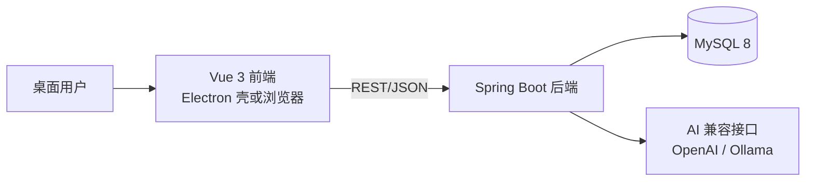
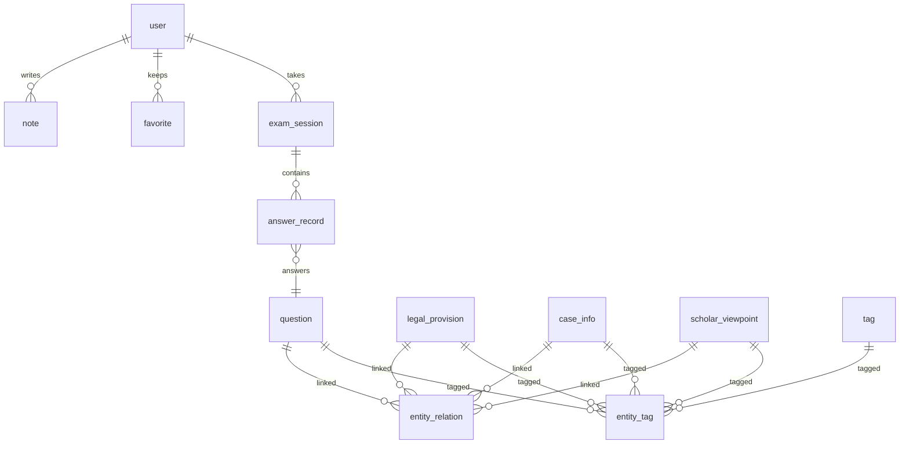

# LexAid 法律学习桌面系统 —— 项目计划书

| 项目名称 | LexAid 法律学习桌面系统 |
| 版本 | v1.0 |
| 日期 | 2026-08-07 |
| 技术架构 | Vue 3 + Spring Boot 3 + MySQL 8（前后端分离，前端可打包为 Electron 桌面应用） |

---

## 1. 项目概述

### 1.1 项目背景

法律学习资料可分为法条、案例、学者观点、习题四类核心知识。传统学习工具（法条库、案例库、刷题 App）彼此割裂，学习者需要在多个系统中来回切换，难以把"法条依据、判例实践、学理阐释、题目训练"串成完整的知识链。

本系统构建一个一体化桌面学习平台，以"关联"为核心：法条与案例互相印证、观点提供学理解释、题目检验掌握程度，并辅以 AI 辅助问答、学习笔记与学习记录，形成"学—练—记—考"闭环。

### 1.2 项目目标

1. 一站式检索阅读：法条检索、案例查询、学者观点导航；
2. 学练结合：模拟答题自动判分，答题解析内嵌关联的法条、案例、观点；
3. 智能辅助：AI 问答基于系统知识内容回答并附来源引用；
4. 个人沉淀：学习笔记与收藏，学习记录统计学习时长、正确率与趋势；
5. 简洁易用：界面干净克制，核心操作不超过 3 步。

### 1.3 项目范围

包含 7 个功能模块及基础能力（登录注册、收藏、标签、全局搜索）。管理端（内容维护）作为可选扩展；数据以"种子数据 + 用户导入"为主，暂不引入 Elasticsearch 等重型组件。

### 1.4 交付物

- 前端工程：Vue 3 + Vite + Element Plus，可打包为 Electron 桌面应用；
- 后端工程：Spring Boot 3 REST API；
- 数据库：MySQL 建表脚本与种子数据；
- 文档：启动部署文档、OpenAPI 接口文档、测试报告。

---

## 2. 需求分析

### 2.1 用户角色

| 角色 | 说明 | 核心权限 |
| --- | --- | --- |
| 学习者 | 系统主要用户 | 检索浏览、答题、AI 问答、笔记、收藏、查看个人统计 |
| 管理员（可扩展） | 维护内容 | 法条/案例/观点/题库增删改、用户管理 |

### 2.2 功能总览

| 模块 | 核心功能 | 优先级 |
| --- | --- | --- |
| 法条检索 | 多条件检索、法条详情、关联内容、收藏 | P0 |
| 案例查询 | 检索、详情（案情 + 裁判要旨 + 依据法条）、关联内容 | P0 |
| 模拟答题 | 组卷、答题、自动判分、解析、错题本 | P0 |
| AI 辅助问答 | 对话问答、知识范围限定、来源引用 | P0 |
| 学习笔记 | 对任意实体记笔记、列表管理 | P0 |
| 学者观点导航 | 按学者/主题浏览、观点详情、来源 | P0 |
| 学习记录 | 答题统计、学习足迹、学习报告 | P1 |
| 基础能力 | 登录注册、收藏、标签、全局搜索 | P0 |

### 2.3 模块需求详述

**2.3.1 法条检索**

- 检索条件：关键词（条文内容/条号）、法律名称、类别、标签；
- 列表：法律名称、条号、内容摘要、类别；
- 详情页：完整条文 + 关联案例（裁判依据）+ 关联观点（学理阐释）+ 关联题目（考点）+ 收藏 + 笔记 + "向 AI 提问"入口；
- 支持收藏列表快捷访问。

**2.3.2 案例查询**

- 检索条件：关键词（标题/案情/裁判要旨）、案由类别、法院、年份；
- 详情页：案情摘要、裁判要旨、案号/法院/程序，依据法条（可跳转）、相关观点、相关题目、笔记、收藏。

**2.3.3 模拟答题**

- 组卷：按类别、难度、题量组卷，支持"随机组卷"与"指定法条/案例/观点相关题"；
- 答题：逐题作答、计时、题卡标记；
- 交卷：自动判分，展示得分、正确率、逐题解析，解析内嵌关联跳转；
- 错题本：自动收录错题，可重新练习。

**2.3.4 AI 辅助问答**

- 对话式问答，保留会话上下文；
- 支持范围限定：全局提问 / 针对某法条 / 某案例 / 某观点；
- 回答附带来源引用（法条/案例/观点卡片可跳转核对）；
- 未配置 AI 服务时降级：提示用户，并返回本地相关检索结果。

**2.3.5 学习笔记**

- 任意详情页可添加/查看笔记；
- 笔记列表按实体类型筛选；
- 笔记内容可关联实体（链接组件）。

**2.3.6 学者观点导航**

- 按学者、主题/标签、关联法条浏览；
- 观点卡片：学者、标题、摘要、来源；
- 详情页：观点内容、关联法条与案例、相关题目。

**2.3.7 学习记录**

- 概览：累计学习时长、答题数、正确率、连续学习天数；
- 趋势图：近 30 天答题量与正确率；
- 类别掌握度：按类别统计正确率；
- 学习足迹：最近浏览与答题记录。

### 2.4 非功能需求

| 类别 | 要求 |
| --- | --- |
| 性能 | 常规接口 P95 < 500ms；列表接口分页；关键字段建索引 |
| 安全 | 密码 BCrypt 加密；JWT 鉴权；防止越权访问；SQL 参数绑定 |
| 兼容 | Chrome/Edge 最新版；Electron 打包支持 Windows/macOS |
| 可维护 | 前后端分层清晰；OpenAPI 文档；建表脚本可重复执行 |
| 界面 | 简洁统一、无冗余装饰，核心操作 ≤ 3 步 |

---

## 3. 总体架构

### 3.1 技术选型

| 层次 | 技术 | 说明 |
| --- | --- | --- |
| 前端框架 | Vue 3.4 + Vite 5 | 组合式 API，`<script setup>` |
| 状态/路由 | Pinia + Vue Router 4 | 登录态、页面路由 |
| UI | Element Plus + ECharts | 组件库 + 统计图表 |
| 桌面壳 | Electron（可选） | 加载前端构建产物 |
| 后端 | Spring Boot 3.2（Java 17） | REST API |
| 安全 | Spring Security + JWT | 无状态鉴权 |
| ORM | MyBatis-Plus | 单表 CRUD + 分页 |
| 数据库 | MySQL 8 | utf8mb4 |
| 接口文档 | springdoc-openapi | /swagger-ui |
| AI | OpenAI 兼容 Chat API | baseUrl/model/apiKey 可配置，兼容本地 Ollama |

### 3.2 架构图



### 3.3 后端模块划分

| 模块 | 职责 |
| --- | --- |
| auth | 注册、登录、当前用户 |
| content | 法条/案例/观点 CRUD 与检索 |
| exam | 组卷、答题、判分、错题 |
| relation | 实体关联查询与维护 |
| note | 笔记 |
| ai | AI 对话（知识上下文注入） |
| stats | 学习统计与足迹埋点 |
| common | 统一响应、异常、分页、JWT 工具 |

---

## 4. 数据模型设计

### 4.1 设计原则

- 四大知识实体：法条、案例、观点、题目；
- 通用关联表 `entity_relation` 承载任意实体之间的多对多关系，支持双向查询；
- 标签体系 `entity_tag` 用于分类与筛选；
- 用户数据（笔记/收藏/记录）全部按 `user_id` 隔离。

### 4.2 核心表结构

**user 用户表**

| 字段 | 类型 | 说明 |
| --- | --- | --- |
| id | BIGINT PK | 自增 |
| username | VARCHAR(50) UNIQUE | 用户名 |
| password | VARCHAR(100) | BCrypt 哈希 |
| nickname | VARCHAR(50) | 昵称 |
| role | VARCHAR(20) | USER / ADMIN |
| created_at / updated_at | DATETIME | 时间戳 |

**legal_provision 法条表**

id（PK）、law_name（法律名称）、category（类别：刑法/民法/行政法等）、chapter（章节）、article_no（条号）、content（TEXT 条文全文）、effective_date（生效日期）、issuing_authority（制定机关，可空）、created_at、updated_at。索引：`law_name`、`category`、`article_no`。

**case_info 案例表**

id（PK）、title（案例名称）、case_no（案号）、court（法院）、judge_date（裁判日期）、case_type（案由/类别）、summary（TEXT 案情摘要）、holding（TEXT 裁判要旨）、procedure（程序：一审/二审/再审）、created_at、updated_at。索引：`case_type`、`judge_date`。

**scholar_viewpoint 学者观点表**

id（PK）、scholar_name（学者姓名）、title（观点标题）、summary（摘要）、content（TEXT 正文，可空）、source（来源：书名/期刊/文章）、publish_year（发表年份）、created_at、updated_at。索引：`scholar_name`。

**question 题目表**

id（PK）、type（SINGLE/MULTIPLE/JUDGE/SHORT）、stem（题干）、options（TEXT JSON：选择题选项数组）、answer（TEXT JSON：选择题键集合/判断题布尔/简答参考答案）、analysis（解析）、difficulty（1~5）、category（类别）、created_at、updated_at。

**exam_session 答题会话表**

id（PK）、user_id、config（TEXT JSON：组卷条件）、score、total、correct、start_time、end_time、duration_sec。

**answer_record 答题明细表**

id（PK）、session_id、user_id、question_id、user_answer（TEXT）、is_correct（BOOLEAN，简答可为 NULL）、answered_at。

**note 笔记表**

id（PK）、user_id、target_type（PROVISION/CASE/VIEWPOINT/QUESTION）、target_id、content（TEXT）、created_at、updated_at。

**favorite 收藏表**

id（PK）、user_id、target_type、target_id、created_at；唯一约束 `(user_id, target_type, target_id)`。

**study_record 学习记录表**

id（PK）、user_id、action_type（VIEW/SEARCH/ANSWER/CHAT/NOTE）、target_type、target_id（可空）、duration_sec、detail（TEXT JSON）、created_at。索引：`(user_id, created_at)`。

**entity_relation 实体关联表**

id（PK）、source_type、source_id、target_type、target_id、relation_type、description；唯一约束 `(source_type, source_id, target_type, target_id, relation_type)`。

**tag / entity_tag**

tag：id、name（UNIQUE）。entity_tag：id、target_type、target_id、tag_id，唯一约束 `(target_type, target_id, tag_id)`。

**chat_message 对话记录表**

id（PK）、user_id、role（USER/ASSISTANT）、content（TEXT）、refs（TEXT JSON：引用来源数组）、created_at。

### 4.3 关系类型字典

| relation_type | 含义 | 示例 |
| --- | --- | --- |
| RELIES_ON | 案例依据法条 | 案例 → 法条 |
| INTERPRETS | 观点阐释法条 | 观点 → 法条 |
| ANALYZES | 观点评析案例 | 观点 → 案例 |
| EXAMINES | 题目考察实体 | 题目 → 法条/案例/观点 |
| RELATED | 一般相关 | 任意实体之间 |

> 约定：双向查询由关系表单条记录 + 服务层反查实现；种子数据尽量成对写入以保证双向可达。

### 4.4 ER 图



---

## 5. 模块详细设计

### 5.1 通用能力

- 统一响应：`{ code, message, data }`；
- 分页参数 `page/size`，返回 `{ records, total }`；
- 全局搜索：`GET /api/search?keyword=` 聚合返回四类实体结果；
- 相关内容聚合：`GET /api/relations/related?sourceType=&sourceId=` 按类型分组返回关联实体；
- 浏览类接口统一写入 `study_record`。

### 5.2 法条检索

页面：检索页（筛选表单 + 列表）、详情页（条文 + 关联区块）。

接口：`GET /api/provisions`、`GET /api/provisions/{id}`、`GET /api/provisions/{id}/related`、`POST /api/provisions/{id}/favorite`。

### 5.3 案例查询

页面：查询页、详情页。

接口：`GET /api/cases`、`GET /api/cases/{id}`、`GET /api/cases/{id}/related`、收藏。

### 5.4 模拟答题

页面：组卷页、答题页（进度 + 计时 + 题卡）、结果页（得分 + 逐题解析）、错题本。

接口：

- `POST /api/exam/sessions`：组卷（按类别/难度/题量/指定实体）；
- `GET /api/exam/sessions/{id}`：取试卷题目（不含答案与解析）；
- `POST /api/exam/sessions/{id}/submit`：交卷判分；
- `GET /api/exam/sessions`：历史试卷；
- `GET /api/wrong-questions`：错题分页。

判分规则：单选/判断严格相等；多选全对才得分；简答不做自动判分（`isCorrect=null`，展示参考答案供自评）。

### 5.5 AI 辅助问答

页面：AI 对话页；详情页提供"针对当前内容提问"入口。

接口：`POST /api/ai/chat`、`GET /api/ai/history`。

逻辑：系统提示词 + 知识上下文（目标实体内容 + 关联摘要）→ OpenAI 兼容接口 → 返回 `answer` 与 `refs`（引用实体的类型/id/标题），前端渲染为可点击卡片。未配置 API Key 时返回降级提示 + 本地相关检索结果兜底。

### 5.6 学习笔记

页面：笔记列表、详情页笔记区块。

接口：`GET /api/notes`、`POST /api/notes`、`PUT /api/notes/{id}`、`DELETE /api/notes/{id}`。

### 5.7 学者观点导航

页面：观点列表（学者/主题筛选）、观点详情。

接口：`GET /api/viewpoints`、`GET /api/viewpoints/{id}`、`GET /api/viewpoints/{id}/related`、收藏。

### 5.8 学习记录

页面：学习统计页。

接口：`GET /api/stats/overview`、`GET /api/stats/daily?days=30`、`GET /api/stats/category-accuracy`、`GET /api/stats/records`。

---

## 6. 关联机制设计（核心亮点）

### 6.1 四类实体关联矩阵

| | 法条 | 案例 | 观点 | 题目 |
| --- | --- | --- | --- | --- |
| 法条 | — | 裁判依据 | 学理阐释 | 考点 |
| 案例 | 依据法条 | — | 学者评析 | 案例题 |
| 观点 | 阐释法条 | 评析案例 | — | 观点题 |
| 题目 | 考察法条 | 考察案例 | 考察观点 | 同源题 |

### 6.2 页面联动规则

- 任意详情页"相关内容"区块 = 关联实体卡片（类型图标 + 标题 + 摘要 + 跳转）；
- 答题解析中嵌入"查看法条 / 查看案例 / 查看观点"按钮；
- 错题本每题提供"相关学习材料"推荐；
- 全局搜索返回四类结果并高亮匹配关键词。

### 6.3 学练闭环

答题 → 判分 → 记录薄弱类别 → 首页推荐相关法条/案例/观点 → 阅读时提问 AI → 记笔记 → 再练错题。

### 6.4 种子数据示例

- 法条：覆盖 3 个类别（如刑法、民法、行政法），每类 3~5 条，使用真实公开条文文本；
- 案例：6 个，每个关联 2~4 条法条；
- 观点：6 条，每条至少关联 1 条法条或 1 个案例；
- 题目：30 道（单选 12 / 多选 6 / 判断 8 / 简答 4），每道关联 1~3 个实体。

---

## 7. 页面与视觉规范

### 7.1 设计原则

简洁、克制、信息优先：白底 + 单一主色；卡片化内容区；避免装饰性元素与复杂动效。

### 7.2 布局

- 顶部栏 56px：Logo、全局搜索框、AI 问答入口、用户菜单；
- 左侧导航 220px：法条、案例、观点、答题、笔记、统计；
- 主内容区：16px 边距，内容最大宽度 1280px。

### 7.3 视觉 Token

| Token | 值 |
| --- | --- |
| 主色 | #2E5FA3 |
| 成功 / 警示 | #67C23A / #E6A23C |
| 正文 / 次要文字 | #303133 / #909399 |
| 边框 | #EBEEF5 |
| 圆角 | 8px |
| 阴影 | 轻阴影（卡片） |

### 7.4 页面清单与路由

| 页面 | 路由 |
| --- | --- |
| 登录/注册 | /login |
| 工作台 | /dashboard |
| 法条检索 | /provisions |
| 法条详情 | /provisions/:id |
| 案例查询 | /cases |
| 案例详情 | /cases/:id |
| 观点导航 | /viewpoints |
| 观点详情 | /viewpoints/:id |
| 组卷 | /exam/setup |
| 答题 | /exam/run/:sessionId |
| 结果 | /exam/result/:sessionId |
| 错题本 | /wrong-book |
| AI 问答 | /ai-chat |
| 学习笔记 | /notes |
| 学习统计 | /stats |
| 个人中心 | /profile |
| 管理端（可选） | /admin/* |

---

## 8. 接口设计概览

| 模块 | 方法 | 路径 | 说明 |
| --- | --- | --- | --- |
| 认证 | POST | /api/auth/register | 注册 |
| 认证 | POST | /api/auth/login | 登录，返回 JWT |
| 认证 | GET | /api/auth/me | 当前用户 |
| 检索 | GET | /api/search | 全局聚合检索 |
| 法条 | GET | /api/provisions | 分页检索 |
| 法条 | GET | /api/provisions/{id} | 详情 |
| 法条 | GET | /api/provisions/{id}/related | 关联内容 |
| 案例 | GET | /api/cases | 分页检索 |
| 案例 | GET | /api/cases/{id} | 详情 |
| 观点 | GET | /api/viewpoints | 分页 |
| 观点 | GET | /api/viewpoints/{id} | 详情 |
| 答题 | POST | /api/exam/sessions | 组卷 |
| 答题 | GET | /api/exam/sessions/{id} | 试卷 |
| 答题 | POST | /api/exam/sessions/{id}/submit | 交卷判分 |
| 答题 | GET | /api/wrong-questions | 错题分页 |
| 笔记 | GET/POST/PUT/DELETE | /api/notes | 笔记 CRUD |
| AI | POST | /api/ai/chat | 问答 |
| 统计 | GET | /api/stats/* | 学习统计 |
| 收藏 | GET/DELETE | /api/favorites | 收藏管理 |

> 详细请求/响应契约由 OpenAPI（/swagger-ui）维护，实现时以本文档字段为准。

---

## 9. 开发计划

### 9.1 里程碑

| 里程碑 | 内容 | 周期 |
| --- | --- | --- |
| M0 | 需求与设计冻结（本文档评审） | 第 1 周 |
| M1 | 工程骨架 + 建表脚本 + 种子数据 | 第 2 周 |
| M2 | 后端核心 API（认证/内容/关联/答题/笔记/统计） | 第 3~5 周 |
| M3 | 前端框架 + 全部业务页面 | 第 5~8 周 |
| M4 | AI 接入 + 统计图表 + Electron 打包 | 第 9~10 周 |
| M5 | 联调、测试、文档、验收 | 第 11 周 |

### 9.2 任务分解

| 阶段 | 任务 | 产出 |
| --- | --- | --- |
| 设计 | 需求评审、数据模型、接口契约 | 本文档 + OpenAPI |
| 数据 | 建表 SQL、种子数据脚本 | schema.sql / data.sql |
| 后端 | 认证与用户 | 注册登录、JWT |
| 后端 | 内容模块 | 法条/案例/观点检索与详情 |
| 后端 | 关联模块 | 关联写入/查询/推荐 |
| 后端 | 答题模块 | 组卷、判分、错题 |
| 后端 | 笔记/收藏 | CRUD |
| 后端 | 统计 | 概览、趋势、掌握度、足迹 |
| 后端 | AI | 对话接口与降级 |
| 前端 | 框架与布局 | 路由、布局、请求封装 |
| 前端 | 内容页面 | 检索/详情/关联区块 |
| 前端 | 答题页面 | 组卷/答题/结果/错题 |
| 前端 | AI 页面 | 对话 UI + 引用卡片 |
| 前端 | 笔记/统计 | 列表、编辑器、ECharts |
| 桌面化 | Electron 壳 | 打包可运行 |
| 测试 | 接口 + 功能 + 验收 | 测试报告 |

### 9.3 团队分工（建议）

前端 1~2 人、后端 2 人、测试 1 人。小团队可由全栈 AI 辅助完成编码，人工负责数据审核与验收。

---

## 10. 测试与验收

### 10.1 测试类型

- 单元测试：判分逻辑、关联查询、JWT；
- 接口测试：全 API 冒烟（带鉴权）；
- 功能测试：按模块验收清单人工走查。

### 10.2 验收标准

1. 注册登录、会话保持正常；
2. 七个模块均可完成核心流程；
3. 四类实体关联跳转全部可用；
4. AI 问答返回带来源引用的回答；未配置时降级不报错；
5. 页面风格统一简洁，无控制台报错；
6. 后端 `mvn spring-boot:run`、前端 `npm run dev` 一键可运行。

---

## 11. 风险与应对

| 风险 | 影响 | 应对 |
| --- | --- | --- |
| 案例/观点文本版权与来源 | 合规 | 仅收录公开裁判文书摘要与公开出版物信息，标注来源；数据由用户导入 |
| AI 回答准确性 | 学习误导 | 限定知识上下文、必须附来源、页面免责声明、一键跳转原文核对 |
| 数据规模增长检索变慢 | 性能 | 建复合索引、分页；必要时引入 Elasticsearch |
| 桌面打包体积 | 分发 | Electron 延迟加载；或先以 Web 形态交付 |

---

## 12. 附录

### 12.1 目录结构规划

```text
lexaid/
├─ backend/     Spring Boot 工程
├─ frontend/    Vue 工程
├─ electron/    Electron 桌面壳（可选）
├─ docs/        计划书、部署文档
└─ scripts/     建表与种子数据
```

### 12.2 术语

- 法条（Legal Provision）：法律法规条文；
- 案例（Case）：裁判案例；
- 观点（Viewpoint）：学者对法律问题的见解；
- 题目（Question）：训练题；
- 关联（Relation）：实体之间的语义关系。
